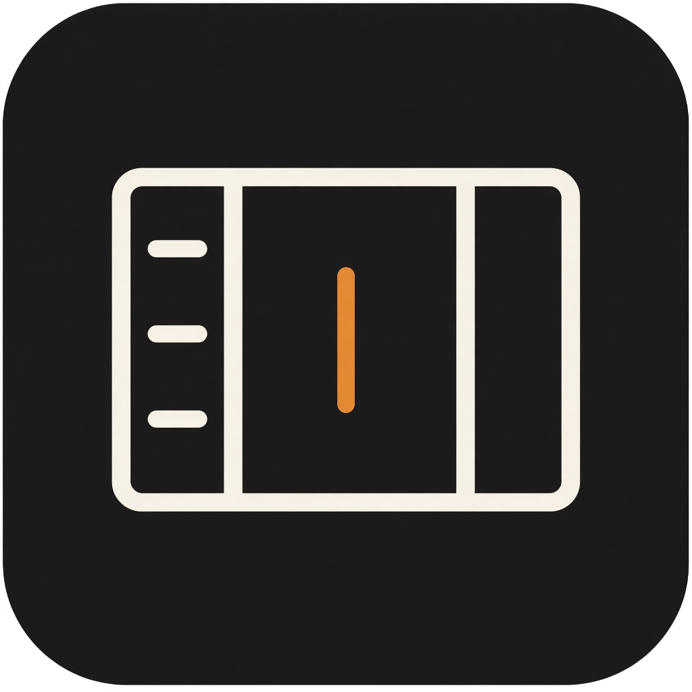
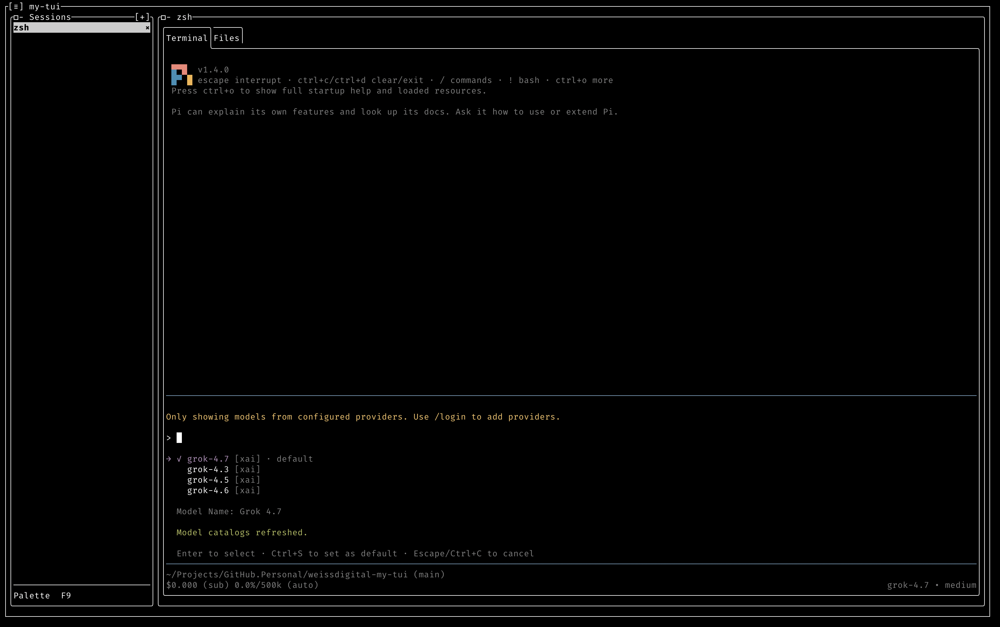

# my-tui





A minimal, terminal-first session orchestrator for bring-your-own CLI agent harnesses.

## Non-goals

- No native agent harness or model integration
- No accounts, login, upgrade prompts, or telemetry
- No git integration, worktrees, or branching UI
- No embedded browser
- No commercial upsell surface
- No attempt to replace Ghostty or iTerm or Warp as a daily terminal

## Install

### macOS

Apple silicon:

```
brew trust rogerwcpt/my-tui
brew install rogerwcpt/my-tui/my-tui
```

Homebrew asks for trust once. The formula keeps `libmytui_pty.dylib` next to the real binary and symlinks `my-tui` onto your PATH.

The release archive is the other route. Download `my-tui-<version>-osx-arm64.tar.gz` from the [latest release](https://github.com/rogerwcpt/weissdigital-my-tui/releases/latest), unpack it, and leave `libmytui_pty.dylib` next to `my-tui`. A browser download is quarantined by Gatekeeper. Clear it with `xattr -d com.apple.quarantine my-tui`.

## Run from source

```
dotnet run --project src/MyTui
```

F9 is the Command Palette where you fill find all the commands in one list.

Ctrl+N creates a session. The command defaults to `$SHELL` and can be edited before it starts. Direct keys work in the session list, the file tree, the preview, and an idle or exited session. Inside a live terminal, Ctrl+B is the leader: the next key is the command, and Ctrl+B a second time sends Ctrl+B to the program. Ctrl+O moves between the session list, the open tab, and the preview. Ctrl+T switches Terminal and Files. Ctrl+P opens or closes the preview panel on the right; it stays there while you use the terminal. Ctrl+E edits the session. Ctrl+R refreshes Files. Delete closes a session, including the key labeled Delete on a Mac. A running session asks first. Delete inside a running terminal still deletes a character. Enter starts a stopped session. Alt+Up and Alt+Down reorder the list. F1 lists the keys. F2 applies a template into the new-session dialog. Shift+PageUp and Shift+PageDown scroll the terminal. The mouse wheel scrolls the history in a shell, scrolls a full-screen program, and is delivered to a program that tracks the mouse. A session you are not viewing shows ● after new output and ! after a bell. Ctrl+Q quits from outside a live terminal, and quitting asks first while any session is still running. Inside a live terminal Ctrl+Q goes to the program; Ctrl+B q quits from there. An optional `leader` in `~/.config/my-tui/config.json` (`ctrl+` a letter, `ctrl+space`, or `ctrl+backslash`) replaces Ctrl+B. Sessions are restored from `~/.config/my-tui/state.json` and are not started until Enter. Templates are `~/.config/my-tui/templates.json`.

Open the command palette with F9 and choose **Duplicate session** to immediately start a fresh terminal using the selected session’s folder, command, arguments, and environment. The copy is named `<original>-2`, then `-3`, and so on, skipping names already in use. The original session keeps running unchanged.

While Files is active, open the command palette with F9 and choose **Open selected file** to launch the selected file in its system-default application (`open` on macOS, `xdg-open` on Linux). Select a file rather than a folder.

## Configuration

Settings live in `~/.config/my-tui/config.json`. Every key is optional.

```json
{
  "theme": "Terminal",
  "leader": "ctrl+b",
  "terminalPalette": "vscode"
}
```

- `theme` sets the chrome colors. Pick it from the command palette, which saves it here.
- `leader` replaces Ctrl+B: `ctrl+` a letter, `ctrl+space`, or `ctrl+backslash`.
- `terminalPalette` sets the 16 ANSI colors inside sessions. Presets are `vscode` (VS Code Dark+, the default), `xterm`, and `tomorrow-night`. An array of up to 16 `#RRGGBB` strings sets colors 0–15 in order (black, red, green, yellow, blue, magenta, cyan, white, then the bright versions); entries you leave out keep VS Code Dark+. An unknown name or a bad color falls back to VS Code Dark+. Colors 16–255 and 24-bit colors are not affected. Restart my-tui after changing it.

```json
{
  "terminalPalette": ["#000000", "#FF5555", "#50FA7B", "#F1FA8C", "#6272FF"]
}
```

## Publish

A push to `main` publishes the next patch release. The assets are `my-tui-<version>-osx-arm64.tar.gz` and `my-tui-<version>-linux-x64.tar.gz`, plus `SHA256SUMS`. The Mac archive includes `libmytui_pty.dylib`, which has to stay next to `my-tui`.

A local folder build is the same pair of runtime identifiers:

```
dotnet publish src/MyTui -c Release -r osx-arm64 --self-contained
dotnet publish src/MyTui -c Release -r linux-x64 --self-contained
```

On macOS the publish step ad-hoc signs `my-tui` and the dylib. If Gatekeeper blocks a copied binary, `xattr -d com.apple.quarantine my-tui`. The Linux build is `linux-x64`, which is the RID the VT library ships. It does not need libicu.
